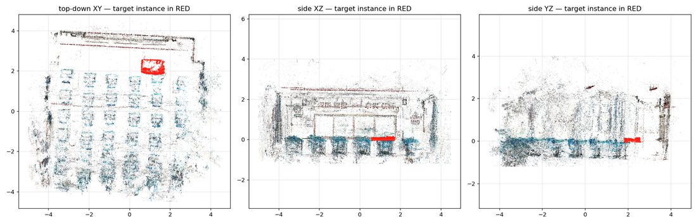
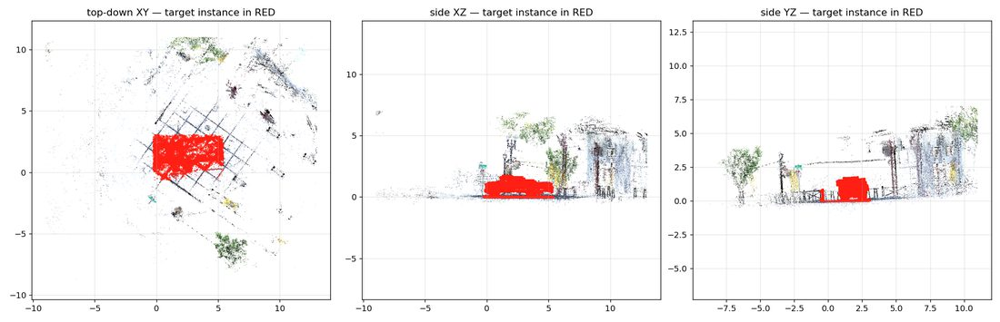
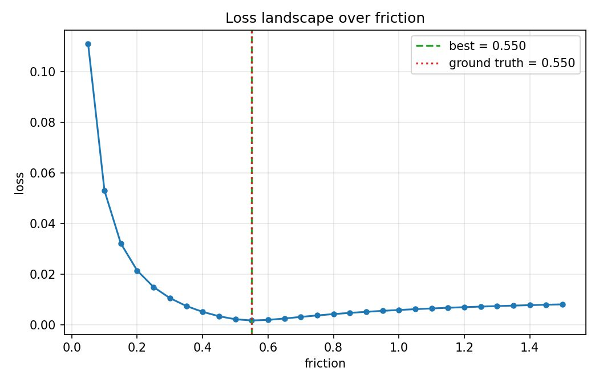
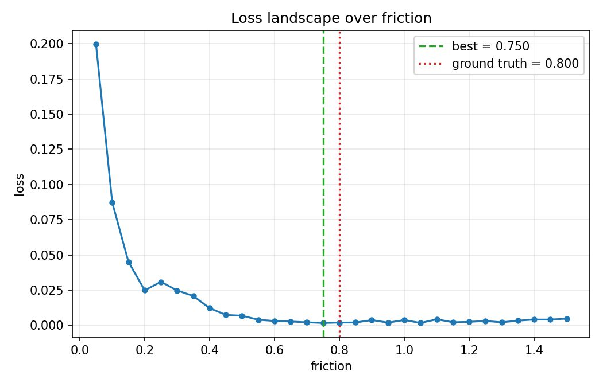
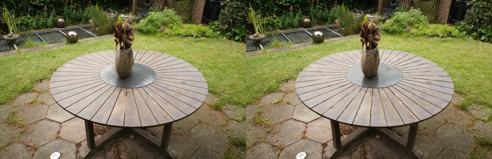
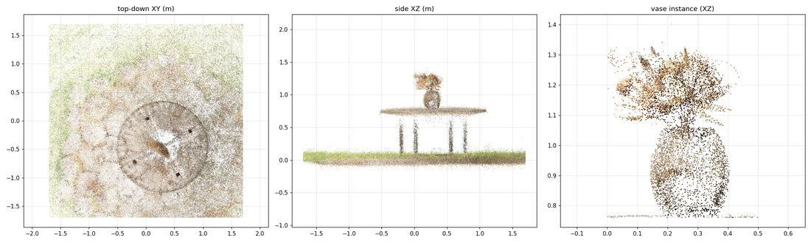

<div align="center">

# Physical Gaussian Digital Twin

**机器人交互数据驱动的三维高斯物理数字孪生构建与自适应校准系统**

[](https://www.python.org/)
[](tests/)
[](LICENSE)
[](src/pgtwin/simulator/)
[](scripts/train_gsplat.py)

*普通 3DGS 解决「看起来像」。本项目解决「动起来对」。*

</div>

---

## 目录

- [核心思想](#核心思想)
- [效果预览](#效果预览)
- [快速开始](#快速开始)
- [完整链路：从照片到校准孪生](#完整链路从照片到校准孪生)
- [实验结果](#实验结果)
- [架构](#架构)
- [坐标系约定](#坐标系约定)
- [数据格式](#数据格式)
- [命令参考](#命令参考)
- [复现环境](#复现环境)
- [项目结构](#项目结构)
- [局限与路线](#局限与路线)
- [引用](#引用)

---

## 核心思想

三维高斯溅射（3DGS）能把真实场景重建为照片级的三维表达，但它**只描述外观，不描述物理**——物体多重、表面多滑、受击如何反弹，无人得知。把这样的场景放进物理引擎，参数只能凭经验填，由此产生的仿真—现实偏差会直接劣化机器人策略训练与部署前验证。

本项目把**机器人本身当作测量仪器**：让机器人对真实物体执行一次交互，把真实世界的响应当作标准答案，通过 real–sim 差异自动反演出物理参数。

```
   多视角照片            3DGS 重建           实例级分离
        │                    │                   │
        ▼                    ▼                   ▼
   ┌─────────┐         ┌──────────┐       ┌────────────┐
   │ 185 张  │────────▶│ 高斯场景 │──────▶│ 目标物体   │
   └─────────┘         └──────────┘       └────────────┘
                                                │
                          ┌─────────────────────┘
                          ▼
              ┌───────────────────────┐
              │  真实机器人交互        │  推 / 滑 / 举
              │  （记录轨迹与力）      │
              └───────────┬───────────┘
                          │  同一动作回放
                          ▼
              ┌───────────────────────┐
              │  仿真环境              │
              └───────────┬───────────┘
                          │
        real trajectory ◀─┴─▶ sim trajectory
                    │
                    ▼  差异 = 损失函数
        ┌───────────────────────────┐
        │  物理参数自动反演          │  θ* = argmin L(θ)
        └───────────┬───────────────┘
                    ▼
        ┌───────────────────────────┐
        │  Physical Gaussian Twin   │  外观 + 碰撞几何 + 标定物理
        └───────────────────────────┘
```

**输出**是一个物体级的孪生体定义，可直接用于机器人仿真、数据生成、模仿学习、VLA 与规划：

```json
{
  "object_id": "vase_01",
  "gaussian_asset": "data/gaussian/garden_scene.npz",
  "collision": { "kind": "cylinder", "params": { "radius": 0.09, "half_height": 0.13 } },
  "physics": { "mass": 1.2, "friction_dynamic": 0.55, "restitution": 0.1 },
  "calibration": {
    "method": "push", "episode": "push_vase_garden_001",
    "trajectory_rmse_cm": 0.18, "improvement_percent": 92.4,
    "ee_replay_rmse_cm": 0.000
  }
}
```

> **本项目不是又一个 3DGS 实现。** 重建、仿真器、机器人全部是适配器；贡献在于它们之间的标定框架。

---

## 效果预览

### 真实场景实例分离

从重建的高斯场景中按世界坐标系包围盒分离目标物体，导出碰撞代理：

| 教室讲桌 | Tanks&Temples 卡车 |
|:---:|:---:|
|  |  |

### 参数可辨识性

损失景观在真值处形成清晰极小值——这是标定结果可信的直接证据：

| 解析后端 | MuJoCo 全物理引擎 |
|:---:|:---:|
|  |  |

### 重建质量（本机从照片训练）

<div align="center">

<br><em>左：真实照片　|　右：本项目在 RTX 4090D 上训练的 3DGS 渲染（留出视角 PSNR 25.6 dB）</em>
</div>

---

## 快速开始

**无需 GPU、无需机器人、无需外部仿真器**，一条命令跑通完整标定闭环：

```bash
git clone https://github.com/ShiXiaoTj/physical_gaussian_twin.git
cd physical_gaussian_twin
pip install -e . --no-build-isolation

# 生成合成"真实"数据（真值摩擦 0.8）并自动标定，恢复摩擦系数
python scripts/run_calibration.py --example push_box
```

预期输出：

```
[ 7] Running initial (uncalibrated) simulation
[ 8] Initial object RMSE = 4.30 cm (params: {'friction': 0.2})
[ 9] Searching parameters: ['friction'] (30 evaluations)
[10] Best parameters: friction = 0.8000
[12] Final object RMSE = 0.18 cm
[13] Improvement = 95.9%  (EE replay RMSE = 0.000 cm)
[14] Saved calibrated Physical Gaussian Twin -> outputs/push_box_001/physical_object.json
```

> 示例数据（`data/generated/`，368 KB）随仓库提供，无需下载任何大文件即可运行。

运行测试：

```bash
pytest tests/ -q          # 183 项，MuJoCo / 真实场景测试在依赖缺失时自动跳过
```

---

## 完整链路：从照片到校准孪生

这是**唯一不借用任何现成资产**的完整链路：从原始照片开始，本机训练 3DGS，再完成标定。

<table>
<tr><td width="50%">

**① 采集与训练**

用 Mip-NeRF360 官方采集（185 张，5187×3361）在本机 RTX 4090D 上训练：

```bash
conda create -n pgtwin-gs python=3.10 -y
conda run -n pgtwin-gs pip install \
    torch==2.4.1 gsplat==1.5.1   # gsplat 提供预编译 wheel

python scripts/train_gsplat.py \
    --data data/mipnerf360/garden \
    --out  data/gaussian/garden_trained \
    --downscale 4 --iters 15000
```

**15k 迭代 / 655 秒 → 1004 万高斯 / PSNR 25.06 dB**

</td><td width="50%">

**② 对齐、定尺度、分离**

```bash
python scripts/prepare_gaussian_scene.py \
    --input  data/gaussian/garden_trained/scene.splat \
    --output data/gaussian/garden_scene.npz \
    --scale 0.56 --plane-threshold 0.05 \
    --crop -1.7 1.7 -1.7 1.7 -0.28 1.7
```

米制尺度**双锚点交叉验证**：桌面高度 1.32→0.74 m（系数 0.568）与桌面直径 3.12→1.78 m（系数 0.570）吻合至 **0.4%**。

</td></tr>
<tr><td colspan="2" align="center">

**③ 标定**

```bash
python scripts/run_calibration.py --example push_vase_garden
```

摩擦系数 **0.2 → 0.55**（真值 0.55），物体轨迹 RMSE **2.34 → 0.18 cm**

</td></tr>
</table>

<div align="center">

<br><em>对齐后的花园场景（米制、地面对齐）：俯视、侧视、花瓶实例</em>
</div>

---

## 实验结果

| # | 实验 | 恢复参数 | 真值 | 初始 → 最终误差 | 改善 |
|:-:|------|---------|------|:---:|:---:|
| 1 | Push 标定（解析物理后端） | friction = 0.80 | 0.80 | 4.30 → 0.18 cm | **95.9%** |
| 2 | Push 标定（MuJoCo 全物理引擎） | friction = 0.75 | 0.80 | 2.71 → 0.18 cm | **93.3%** |
| 3 | 真实 3DGS 场景（教室讲桌） | friction = 0.50 | 0.50 | 3.45 → 0.18 cm | **94.9%** |
| 4 | 真实场景 playroom 儿童椅 | friction = 0.60 | 0.60 | 3.84 → 0.18 cm | **95.4%** |
| 5 | 车辆尺度泛化（卡车 6.7 m） | friction = 0.70 | 0.70 | 10.44 → 0.35 cm | **96.7%** |
| 6 | **全链路自建：照片 → 训练 → 标定** | friction = 0.55 | 0.55 | 2.34 → 0.18 cm | **92.4%** |
| 7a | 分层标定 Stage 1：LIFT → 质量 | mass = 0.40 kg | 0.42 | 5.69 → 0.20 N | **96.4%** |
| 7b | 分层标定 Stage 2：PUSH → 摩擦 | friction = 0.80 | 0.80 | 4.32 → 0.18 cm | **95.9%** |

所有实验均从**错误的初值**出发，与真值对照。每次运行自动留档于 `outputs/<experiment_id>/`：配置快照、结果 JSON、搜索历史、轨迹 CSV、图表与校准后的孪生体定义。

### 关键设计要点

| # | 设计要点 | 代码锚点 |
|:-:|--------|---------|
| 1 | 以机器人**真实交互数据**（而非纯视觉）校准高斯孪生的物理参数 | [`physics/calibrator.py`](src/pgtwin/physics/calibrator.py) |
| 2 | 真实与仿真执行**同一动作**，以 real–sim 轨迹差构造优化目标；并以 **EE 回放误差**审计动作保真度 | [`simulator/replay.py`](src/pgtwin/simulator/replay.py) |
| 3 | 按「动作—参数—观测量」敏感性**分阶段辨识**，规避耦合参数不可辨识 | [`physics/sensitivity.py`](src/pgtwin/physics/sensitivity.py) |
| 4 | 高斯视觉表达与物理表达的**物体级绑定** | [`gaussian/gaussian_object.py`](src/pgtwin/gaussian/gaussian_object.py) |
| 5 | **迭代式自适应孪生**：交互 → 仿真 → 差异 → 参数更新 → 再仿真 | [`PhysicsCalibrator.calibrate`](src/pgtwin/physics/calibrator.py) |

### 可辨识性

并非所有参数都能由同一动作观测。准静态推动下自由滑行距离为 `v²/(2μg)`，**与质量无关**——「推一次同时标定摩擦与质量」在数学上是病态的。本项目把该规律固化为代码约束：敏感性策略会**拒绝**不可辨识的参数组合。

更进一步，**观测量本身的选取**也决定可辨识性。运动学抓取条件下，举升轨迹由夹爪强加、完全不含质量信息；质量的可观测量是夹持力 `F = m(a+g)`。本项目以负对照实验验证：对 LIFT 数据强制使用轨迹损失时，质量维度的损失景观完全平坦（波动 < 5%）；切换为力损失后方可辨识。

| 动作 | 可辨识参数 | 观测量 | 状态 |
|------|-----------|--------|------|
| PUSH / SLIDE | 动摩擦系数 | 物体轨迹 | ✅ 已验证 |
| LIFT | 质量 | 夹持力 (N) | ✅ 已验证 |
| COLLISION | 恢复系数 | 物体轨迹 | 接口就绪 |
| PRESS | 杨氏模量 / 泊松比 | 接触力 | 接口就绪 |

---

## 架构

```
src/pgtwin/
├── common/       SE(3) 位姿与四元数、坐标帧注册、IO、日志
├── real_data/    episode 数据模型、加载、时间对齐、合成数据
├── robot/        BaseRobot + Franka / Piper 适配器
├── simulator/    BaseSimulator + MockSimulator / MuJoCoSimulator、动作回放
├── physics/      物理对象、参数空间、损失、优化器、敏感性策略、标定器
├── gaussian/     高斯场景、实例分离、碰撞代理、COLMAP 解析、CPU EWA 光栅器
├── evaluation/   指标（cm / deg）、可视化、实验留档
└── cli/          pgtwin calibrate | evaluate | reconstruct
```

**依赖方向严格向下**：`cli → {physics, simulator, evaluation} → {real_data, gaussian} → common`。
`physics/calibrator.py` 只通过 `BaseSimulator` 与仿真器交互——把 MuJoCo 换成 Isaac 只需改一行配置。

| 层次 | 现有实现 | 接口 | 规划 |
|------|---------|------|------|
| 仿真器 | `MockSimulator`（解析）、**`MuJoCoSimulator`（已验证）** | `BaseSimulator` | Isaac Sim |
| 机器人 | Franka / Piper（运动学描述） | `BaseRobot` | 真机 SDK 控制 |
| 重建 | PLY / splat / NPZ 导入、**gsplat 本机训练** | `GaussianReconstructionBackend` | Splatfacto、PhysGaussian |
| 优化器 | 网格搜索、随机搜索 | `BaseOptimizer` | 贝叶斯（skopt）、可微分 |

---

## 坐标系约定

坐标系是本类系统**最主要的错误来源**，因此固化为类型与命名约定，并由单元测试锁定。

- **右手系，世界系 z 轴向上**，重力 `[0, 0, -9.81]`
- **四元数统一为 `[x, y, z, w]`**（标量在后），跨模块与文件格式唯一；对外部约定（MuJoCo 的 wxyz、3DGS PLY 的 wxyz）在边界处显式转换
- 变换命名 `T_父_子`，满足 `p_父 = T_父_子 · p_子`，组合时下标相接：`T_world_ee = T_world_robot · T_robot_ee`
- episode 中机器人状态记录 `T_world_ee`，物体状态记录 `T_world_object`，**一律世界系**
- 内部单位：米 / 弧度；报告与指标改为厘米 / 度，且**单位写入字段名**（`rmse_position_cm`、`rotation_error_deg`）
- 仿真后端必须还原到世界系（`T_sim_world` 为单位阵），使 real 与 sim 轨迹可直接比较，不引入隐藏变换

详见 [docs/architecture.md](docs/architecture.md)。

---

## 数据格式

一个交互 episode 对应一个目录：

```
episode_0001/
├── metadata.json        # episode_id, action_type, robot, object_id, sampling_rate, ...
├── robot_states.csv     # timestamp, ee_x..ee_z, ee_qx..ee_qw, gripper[, fx fy fz]
├── object_states.csv    # timestamp, x y z, qx qy qz qw
├── camera/              # 可选：原始采集
└── scene/               # 可选：高斯资产
```

全部位姿为世界系；四元数为 `[x, y, z, w]`；时间戳为秒。加载器会校验字段、排序去重、归一化时间原点并可重采样。

生成模板 episode：

```bash
python scripts/generate_synthetic_episode.py --out data/generated/my_push --friction 0.6
```

---

## 命令参考

### 标定与评估

```bash
pgtwin calibrate  --episode data/real/push_001 --config configs/experiments/push_box.yaml
pgtwin evaluate   --experiment outputs/push_box_001
pgtwin reconstruct --backend ply_import --ply scene.ply --out data/gaussian/scene.npz
```

### 内置示例

```bash
python scripts/run_calibration.py --example push_box             # 解析后端
python scripts/run_calibration.py --example push_box_mujoco      # MuJoCo 全物理
python scripts/run_calibration.py --example push_desk_real_scene # 真实 3DGS 场景
python scripts/run_calibration.py --example push_chair_playroom  # Deep Blending
python scripts/run_calibration.py --example slide_truck          # 车辆尺度
python scripts/run_calibration.py --example push_vase_garden     # 全链路自建
python scripts/run_hierarchical.py --example lift_push           # 分层标定
```

### 数据与可视化

```bash
python scripts/validate_episode.py data/real/my_episode   # 真机数据自检
python scripts/build_demo_report.py                       # HTML 演示报告
python scripts/build_report_docx.py                       # Word 技术报告
python scripts/render_video.py splat --experiment outputs/<id> --scene <场景.npz> \
    --bbox x0 y0 z0 x1 y1 z1 --eye x y z --lookat x y z  # 标定前后对比视频
```

---

## 复现环境

| 依赖 | 用途 | 安装 |
|------|------|------|
| numpy, scipy, pandas, matplotlib, pyyaml | 核心 | `pip install -e .` |
| pytest | 测试 | `pip install -e ".[dev]"` |
| mujoco ≥ 3.1 | 全物理后端 | `pip install mujoco` |
| torch + gsplat | 本机训练 3DGS | 见 [完整链路](#完整链路从照片到校准孪生) |

```bash
pip install -e . --no-build-isolation   # 离线环境
```

**优雅降级**：缺少 MuJoCo、CUDA 或机器人时，完整管线仍可在解析后端 + 合成数据上运行。

---

## 项目结构

```
physical_gaussian_twin/
├── src/pgtwin/          核心库（8 个模块）
├── scripts/             可执行脚本（训练 / 标定 / 可视化 / 报告）
├── configs/             YAML 配置（default / robot / scene / experiments）
├── tests/               183 项测试
├── docs/                架构、实验协议、路线图
├── examples/            按示例组织的说明
├── data/
│   ├── generated/       随仓库提供的合成示例 episode（368 KB）
│   ├── real/            真实数据（需自备）
│   └── gaussian/        高斯场景（由脚本下载 / 训练生成，不入库）
└── outputs/             实验产物（运行时生成，不入库）
```

### 文档索引

| 文档 | 内容 |
|------|------|
| [docs/architecture.md](docs/architecture.md) | 架构说明，含坐标系约定专章 |
| [docs/experiment_protocol.md](docs/experiment_protocol.md) | 实验协议（含真实物理引擎上沉淀的设计规则） |
| [docs/roadmap.md](docs/roadmap.md) | 阶段进展与后续规划 |
| [CHANGELOG.md](CHANGELOG.md) | 版本变更记录 |
| [CURRENT_STATE.md](CURRENT_STATE.md) | 环境勘察与工程决策记录 |

---

## 局限与路线

**已知局限**

- 解析后端仅覆盖平面推动的准静态模型；MuJoCo 后端的恢复系数映射仍为近似
- 已完成摩擦（PUSH/SLIDE）与质量（LIFT）的标定验证；恢复系数与刚度待补数据生成器
- 实例分离当前为手工包围盒（按设计与其他模块解耦），后续可替换为 SAM / 语义分割
- 单段数据在 1 mm 跟踪噪声下存在 −0.05～−0.10 的摩擦低偏，多段联合标定可收紧

**路线**

| 阶段 | 内容 | 状态 |
|------|------|------|
| 0–6 | 核心数据模型 → 合成闭环 → MuJoCo 验证 → 高斯接入 → 碰撞代理 | ✅ 完成 |
| 7 | 真机实验：≥5 次推动 × ≥2 物体 × ≥2 表面 | ⏸ 待机器人数据 |
| 8 | 分层标定、质量标定 | ✅ 完成 |
| 扩展 | 恢复系数 / 刚度标定、GPU 渲染后端、Isaac Sim、SAM 分割 | 规划中 |

详见 [docs/roadmap.md](docs/roadmap.md)。

---

## 引用

```bibtex
@misc{pgtwin2026,
  title  = {Physical Gaussian Digital Twin: Robot-Interaction-Driven
            Physics Calibration for 3D Gaussian Scenes},
  author = {ShiXiaoTj},
  year   = {2026},
  url    = {https://github.com/ShiXiaoTj/physical_gaussian_twin}
}
```

**致谢**：3DGS 原始工作（Kerbl et al., SIGGRAPH 2023）、[gsplat](https://github.com/nerfstudio-project/gsplat)、
MuJoCo、Mip-NeRF360 / Tanks&Temples / Deep Blending 数据集。
本项目**不重新实现**任何 3DGS 或物理引擎，全部以适配器接入。

## 许可

[MIT](LICENSE)
